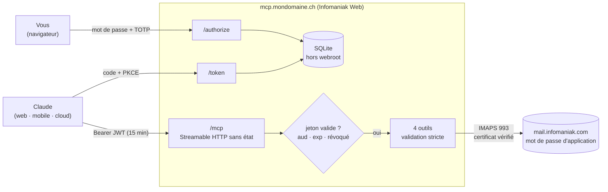
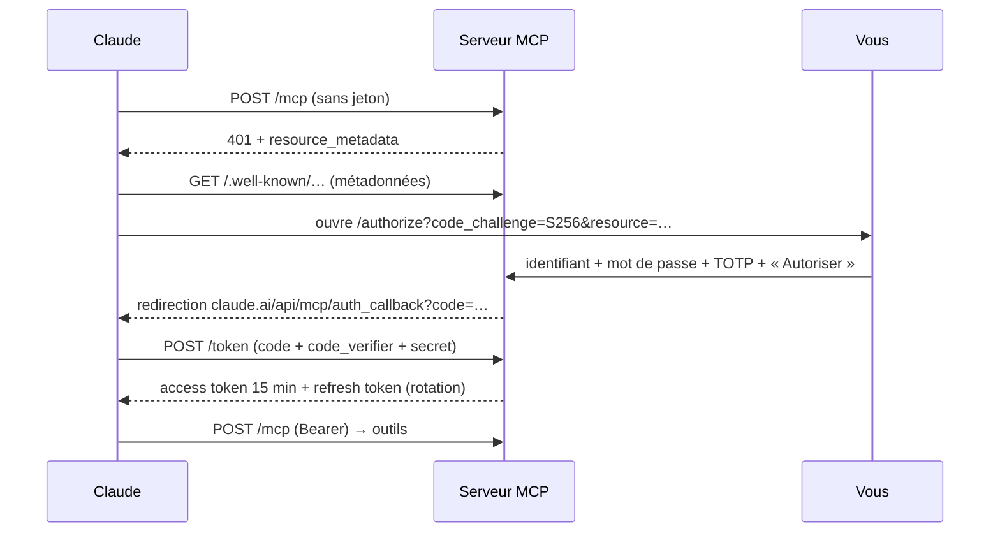

<div align="center">

# 📬 Mail MCP — Infomaniak

**Donnez à Claude un accès _limité_ et _sûr_ à votre boîte mail : lire, chercher, rédiger des brouillons. Jamais envoyer.**


-0098FF)

[Démarrage rapide](#-démarrage-rapide) · [Outils](#-outils) · [Architecture](#-architecture) · [Déploiement](#déploiement-chez-infomaniak-offre-web) · [Connecteur claude.ai](#ajouter-le-connecteur-dans-claudeai) · [Urgence](#procédure-durgence) · [Sécurité](SECURITY.md)

</div>

---

Serveur MCP distant qui donne à Claude (connecteur personnalisé claude.ai : web, mobile, Claude Code cloud)
un accès **limité** à une boîte mail Infomaniak : lecture et création de brouillons. **Aucun envoi, aucune suppression,
aucun déplacement, aucune modification de drapeau, aucun téléchargement de pièce jointe, aucune connexion SMTP.**

> [!IMPORTANT]
> La sécurité prime sur les fonctionnalités. Ce qui n'est pas codé ne peut pas être détourné : le pire qu'une
> injection de prompt puisse faire, c'est créer un **brouillon** que vous relisez avant de l'envoyer vous-même.

## ✨ En bref

- 🔒 **Lecture seule + brouillons** : 4 outils, aucune capacité destructive, pas de SMTP.
- 🪪 **OAuth 2.1 complet** : PKCE S256 obligatoire, jetons de 15 min liés à l'URL du serveur (RFC 8707), refresh tokens à rotation avec détection de réutilisation.
- 🔑 **Connexion forte** : mot de passe Argon2id + code TOTP à chaque autorisation, verrouillage après 5 échecs.
- 🧯 **Kill switch** : une commande révoque tous les jetons instantanément.
- 🧪 **Contenu non fiable balisé** : les mails arrivent dans `untrusted_content`, jamais comme instructions.
- 🪶 **Mutualisé friendly** : PHP-FPM + `.htaccess`, une requête = un process, SQLite, aucun démon.

## 🚀 Démarrage rapide

```sh
git clone https://github.com/xiff/Mcp-php-mail.git && cd Mcp-php-mail
composer install --no-dev -o
cp config/config.example.php config/config.php && chmod 600 config/config.php
php bin/generate-keys.php && php bin/hash-password.php && php bin/create-totp.php && php bin/create-client.php
bin/check-exposure.sh https://mcp.mondomaine.ch   # tout doit afficher « ok »
```

Puis dans claude.ai : **Connecteurs → Ajouter** → `https://mcp.mondomaine.ch/mcp` + Client ID/Secret. Détails pas à pas [plus bas](#déploiement-chez-infomaniak-offre-web).

## 🏗 Architecture



### Flux de connexion



## 🧰 Outils

| Outil | Effet | Annotations |
|---|---|---|
| `list_folders` | noms des dossiers | readOnly, non destructif |
| `search_messages(folder, query?, from?, since?, unseen_only?, limit≤50)` | UID, date, expéditeur, sujet, extrait ≤ 200 car., indicateurs | readOnly |
| `get_message(folder, uid)` | en-têtes + corps texte brut (HTML nettoyé), tronqué à 50 ko ; pièces jointes en métadonnées | readOnly |
| `create_draft(to[], subject, body_text, in_reply_to_uid?, in_reply_to_folder?)` | APPEND dans Brouillons avec `\Draft`, `In-Reply-To`/`References` | non readOnly, non destructif |

Le contenu des mails est renvoyé dans un champ `untrusted_content`, et chaque description d'outil rappelle de ne jamais
suivre les instructions qu'il contient.

## Ce qui a été vérifié avant d'écrire le code (25/11/2026)

1. Spec MCP Authorization **2025-11-25** : le serveur MCP expose RFC 9728 ; le serveur d'autorisation expose RFC 8414 ; une requête sans jeton reçoit `401` + `WWW-Authenticate: Bearer resource_metadata="…"`.
2. `code_challenge_methods_supported` est obligatoire dans les métadonnées, sinon le client abandonne. Seul `S256` est annoncé.
3. Le client envoie `resource` (RFC 8707) à `/authorize` et `/token` ; le serveur DOIT refuser tout jeton dont l'audience n'est pas la sienne.
4. Enregistrement des clients selon la spec : pré-enregistrement, puis CIMD, puis DCR (le DCR n'est conservé que pour compatibilité).
5. Doc Claude (claude.com/docs/connectors/building/authentication) : Claude gère DCR et CIMD par défaut, et accepte un Client ID / Secret saisis dans le dialogue du connecteur personnalisé (secret facultatif).
6. Callback des applications hébergées (web, desktop, mobile) : **exactement** `https://claude.ai/api/mcp/auth_callback`. Claude Code local utilise un callback loopback, non pris en charge ici.
7. Claude exige PKCE S256, rafraîchit le jeton sur 401 et jusqu'à 5 min avant expiration, et attend `invalid_grant` pour un refresh token invalide. La rotation est acceptée.
8. Les requêtes de Claude partent de `160.79.104.0/21`. Aucun en-tête `Origin` n'est documenté (appels serveur à serveur).
9. Streamable HTTP : le serveur DOIT valider `Origin` (403 sinon). L'ID de session est facultatif, donc un serveur sans session est conforme.
10. SDK `mcp/sdk` 0.10.0 : `StreamableHttpTransport` sans `setSession()` fonctionne sans session, une requête = un process PHP. Testé, ce mode convient au mutualisé.

## Écarts et choix restrictifs à connaître

- **Enregistrement** : un client **pré-enregistré** et confidentiel est créé par CLI. Le DCR est **désactivé** ; il s'active par drapeau avec une liste blanche exacte de `redirect_uris` et un nombre maximal de clients. Le **CIMD n'est pas implémenté** : il obligerait le serveur à télécharger des documents distants (surface d'attaque SSRF). Si votre compte claude.ai n'affiche pas les champs Client ID / Secret, activez le DCR (voir plus bas).
- **Pas de session de connexion** : au lieu de `session_regenerate_id`, chaque demande d'autorisation crée un enregistrement à **usage unique** (cookie `__Host-`, 10 min, CSRF). Il est détruit dès la connexion. Chaque autorisation exige donc mot de passe + TOTP ; il n'existe pas de « rester connecté ».
- **Connexion et consentement sur un seul écran** : client, domaine de retour et droits sont affichés au-dessus du formulaire, avec un bouton « Refuser ».
- **JWT RS256** (et non EdDSA) : `league/oauth2-server` ne signe qu'en RS256 (clé RSA 3072 bits).
- **`resource` au rafraîchissement** : obligatoire pour l'échange du code, et vérifié s'il est présent lors du rafraîchissement. L'audience du jeton reste toujours l'URL `/mcp`.
- **`in_reply_to_folder`** a été ajouté, car un UID IMAP n'a de sens que dans un dossier (défaut `INBOX`).
- **`send_draft`** n'existe pas. Le bloc `send` de la config (désactivé, liste blanche de destinataires) réserve la place ; l'interface `MailStore` n'a aucune méthode d'envoi.
- **Verrouillage global** après 5 échecs : un attaquant peut vous bloquer 15 min (voir SECURITY.md).
- **PHP minimum : 8.3**, imposé par `illuminate/collections` 13, une dépendance d'ImapEngine. Compatible avec 8.4 et 8.5 selon les contraintes des paquets ; les tests ont tourné sous 8.3.

### Pourquoi ImapEngine plutôt que webklex/php-imap

`directorytree/imapengine` est en PHP pur, sans `ext-imap` (retirée de PHP 8.4), et activement maintenue. Elle lit les corps en `BODY.PEEK` (la lecture ne pose pas `\Seen`) et échappe elle-même les chaînes de recherche et de dossier. Elle permet aussi de récupérer **une seule partie MIME** : seules les parties texte/HTML sont téléchargées, jamais les pièces jointes. Inconvénient : elle tire `illuminate/collections` et `nesbot/carbon`, mais webklex en dépend aussi.

## Arborescence

```
public/       index.php + .htaccess UNIQUEMENT (racine web du sous-domaine)
src/          App (routeur, OAuth, MCP), OAuth/, Mail/, Mcp/, AuditLog, RateLimiter, Db
bin/          scripts CLI
config/       config.php + keys/ (ignorés par git, 600/700)
var/          app.sqlite, log/ (ignoré par git, 700)
tests/        PHPUnit (IMAP simulé)
```

## Déploiement chez Infomaniak (offre Web)

1. **Sous-domaine** : Manager → Hébergement Web → *Sites* → ajouter `mcp.mondomaine.ch`, puis définir son **dossier racine** sur `…/mcp-php-mail/public`.
2. **Certificat** : sur le site, *SSL* → Let's Encrypt. Activez aussi « forcer HTTPS ».
3. **PHP** : sur le site, *Gestion PHP* → choisissez **8.3 ou plus récent**. Extensions requises : `pdo_sqlite`, `openssl`, `mbstring`, `sodium`. Vérifiez que `display_errors` est sur **Off**.
4. **SSH** (activez-le dans le Manager si besoin) :
   ```sh
   cd ~/sites
   git clone <votre-dépôt> mcp-php-mail && cd mcp-php-mail
   composer install --no-dev --optimize-autoloader
   cp config/config.example.php config/config.php
   chmod 700 config var 2>/dev/null; mkdir -p var && chmod 700 var; chmod 600 config/config.php
   ```
5. **Mot de passe d'application** : Manager → Service Mail → votre adresse → *Mots de passe d'application* → en créer un dédié « Claude MCP ». Placez-le dans `imap.password`. **N'utilisez jamais le mot de passe principal.**
6. **Secrets** (chaque commande affiche une valeur à copier dans `config/config.php`) :
   ```sh
   php bin/generate-keys.php      # clés RSA + oauth.encryption_key
   php bin/hash-password.php      # owner.password_hash (Argon2id, min. 16 caractères)
   php bin/create-totp.php        # owner.totp_secret + URI otpauth:// à scanner
   php bin/create-client.php      # Client ID + Client Secret (affichés une seule fois)
   history -c
   ```
   Renseignez aussi `base_url`, `imap.username` et `imap.drafts_folder` (le nom exact renvoyé par `list_folders` ; chez Infomaniak, normalement `Drafts`).
7. **Permissions finales** : `chmod 600 config/config.php config/keys/*; chmod 700 config config/keys var var/log`.
8. **Vérification externe** : `bin/check-exposure.sh https://mcp.mondomaine.ch`. Chaque ligne doit afficher `ok`.

Mise à jour : `git pull && composer install --no-dev -o && composer audit`.

## Ajouter le connecteur dans claude.ai

1. claude.ai → *Paramètres* → *Connecteurs* → *Ajouter un connecteur personnalisé*.
2. URL : `https://mcp.mondomaine.ch/mcp`.
3. *Paramètres avancés* : collez le **Client ID** et le **Client Secret** donnés par `bin/create-client.php`.
4. *Connecter* : la page de connexion du serveur s'ouvre. Saisissez identifiant, mot de passe et code TOTP, puis cliquez sur « Se connecter et autoriser ».
5. Le connecteur est ensuite disponible sur le web, l'app mobile et les sessions Claude Code cloud.

**Sans champs Client ID / Secret** : mettez `oauth.dcr_enabled => true` (les valeurs par défaut gardent la liste blanche `https://claude.ai/api/mcp/auth_callback` et 2 clients au maximum), ajoutez le connecteur, puis **remettez `false`** une fois connecté. Les clients créés restent valides.

## Rotation du mot de passe d'application

1. Créez un nouveau mot de passe d'application chez Infomaniak.
2. Remplacez `imap.password` dans `config/config.php`.
3. Supprimez l'ancien dans le Manager.

Aucun redémarrage n'est nécessaire, car chaque requête relit la config.

## Procédure d'urgence

Si vous soupçonnez un vol de jeton, un appareil perdu ou une activité anormale dans `var/log/audit.log` :

1. **Kill switch** : `php bin/revoke-all.php`. Tous les jetons deviennent invalides **immédiatement**, car chaque appel MCP vérifie la base. Ajoutez `--clients` pour supprimer aussi les clients OAuth.
2. **Infomaniak** : révoquez le **mot de passe d'application** dans le Manager. La boîte est alors inaccessible même si `config.php` a fui.
3. Si l'hébergement lui-même est suspect : `php bin/generate-keys.php --force`, puis changez le mot de passe propriétaire (`hash-password.php`), le secret TOTP (`create-totp.php`) et le client (`revoke-all.php --clients` puis `create-client.php`).
4. Pour couper totalement le service, renommez `config/config.php` : le serveur répond alors 503.

## Tests

```sh
composer install
vendor/bin/phpunit       # flux OAuth complet, rejets, validation des outils, logs sans secret
composer audit
```

Durcissement optionnel : dans `.htaccess`, limiter `/mcp`, `/token` et `/revoke` à `160.79.104.0/21` (plage sortante de Claude). Ne restreignez **pas** `/authorize`, que votre navigateur doit pouvoir joindre.
