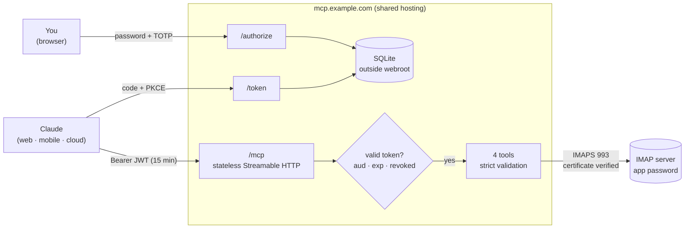
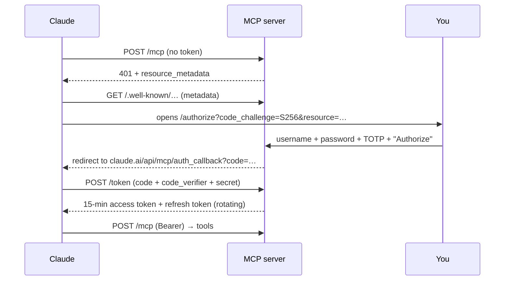

<div align="center">

# 📬 Mail MCP

**Give Claude _limited_, _safe_ access to your mailbox: read, search, draft. Never send.**


[Quick start](#-quick-start) · [Tools](#-tools) · [Architecture](#-architecture) · [Deployment](#deployment-shared-php-hosting) · [claude.ai connector](#adding-the-connector-in-claudeai) · [Emergency](#emergency-procedure) · [Security](SECURITY.md)

</div>

---

A remote MCP server that gives Claude (claude.ai custom connector: web, mobile, Claude Code cloud sessions)
**limited** access to one IMAP mailbox: reading and creating drafts. **No sending, no deleting, no moving,
no flag changes, no attachment downloads, no SMTP connection at all.**

> [!IMPORTANT]
> Security comes before features. What isn't coded can't be abused: the worst a prompt injection can do is
> create a **draft** that you review before sending it yourself.

## ✨ At a glance

- 🔒 **Read-only + drafts**: 4 tools, no destructive capability, no SMTP.
- 🪪 **Full OAuth 2.1**: mandatory PKCE S256, 15-minute tokens bound to the server URL (RFC 8707), rotating refresh tokens with reuse detection.
- 🔑 **Strong login**: Argon2id password + TOTP code on every authorization, lockout after 5 failures.
- 🧯 **Kill switch**: one command revokes every token instantly.
- 🧪 **Untrusted content is labeled**: mail content arrives in `untrusted_content`, never as instructions.
- 🪶 **Shared-hosting friendly**: PHP-FPM + `.htaccess`, one request = one process, SQLite, no daemon.

## 🚀 Quick start

```sh
git clone https://github.com/xiff/Mcp-php-mail.git && cd Mcp-php-mail
composer install --no-dev -o
cp config/config.example.php config/config.php && chmod 600 config/config.php
php bin/generate-keys.php && php bin/hash-password.php && php bin/create-totp.php && php bin/create-client.php
bin/check-exposure.sh https://mcp.example.com   # every line must say "ok"
```

Then in claude.ai: **Connectors → Add** → `https://mcp.example.com/mcp` + Client ID/Secret. Step-by-step details [below](#deployment-shared-php-hosting).

## 🏗 Architecture



### Login flow



## 🧰 Tools

| Tool | Effect | Annotations |
|---|---|---|
| `list_folders` | folder names | readOnly, non-destructive |
| `search_messages(folder, query?, from?, since?, unseen_only?, limit≤50)` | UID, date, sender, subject, ≤ 200-char snippet, flags | readOnly |
| `get_message(folder, uid)` | headers + plain-text body (HTML sanitized), truncated to 50 KB; attachments as metadata only | readOnly |
| `create_draft(to[], subject, body_text, in_reply_to_uid?, in_reply_to_folder?)` | APPEND to Drafts with `\Draft`, `In-Reply-To`/`References` | not readOnly, non-destructive |

Mail content is returned in an `untrusted_content` field, and every tool description reminds the model never to
follow instructions found inside it.

## What was verified before writing the code (2026-11-25)

1. MCP Authorization spec **2025-11-25**: the MCP server exposes RFC 9728; the authorization server exposes RFC 8414; a request without a token gets `401` + `WWW-Authenticate: Bearer resource_metadata="…"`.
2. `code_challenge_methods_supported` is mandatory in the metadata, otherwise the client gives up. Only `S256` is advertised.
3. The client sends `resource` (RFC 8707) to `/authorize` and `/token`; the server MUST reject any token whose audience isn't itself.
4. Client registration per the spec: pre-registration, then CIMD, then DCR (DCR is kept only for backward compatibility).
5. Claude docs (claude.com/docs/connectors/building/authentication): Claude supports DCR and CIMD by default, and accepts a Client ID / Secret entered in the custom connector dialog (secret optional).
6. Callback for hosted apps (web, desktop, mobile): **exactly** `https://claude.ai/api/mcp/auth_callback`. Local Claude Code uses a loopback callback, not supported here.
7. Claude requires PKCE S256, refreshes on 401 and up to 5 min before expiry, and expects `invalid_grant` for an invalid refresh token. Rotation is supported.
8. Claude's requests come from `160.79.104.0/21`. No `Origin` header is documented (server-to-server calls).
9. Streamable HTTP: the server MUST validate `Origin` (403 otherwise). The session ID is optional, so a sessionless server is compliant.
10. `mcp/sdk` 0.10.0: `StreamableHttpTransport` without `setSession()` runs sessionless, one request = one PHP process. Tested; this mode works on shared hosting.

## Deviations and restrictive choices

- **Registration**: a **pre-registered**, confidential client is created via CLI. DCR is **disabled**; it can be enabled by flag, with an exact `redirect_uris` allowlist and a maximum number of clients. **CIMD is not implemented**: it would make the server fetch remote documents (SSRF surface). If your claude.ai account doesn't show the Client ID / Secret fields, enable DCR (see below).
- **No login session**: instead of `session_regenerate_id`, each authorization request creates a **single-use** record (`__Host-` cookie, 10 min, CSRF), destroyed as soon as you log in. Every authorization therefore requires password + TOTP; there is no "stay signed in".
- **Login and consent on one screen**: client, return domain and requested rights are shown above the form, with a "Deny" button.
- **RS256 JWTs** (not EdDSA): `league/oauth2-server` only signs with RS256 (3072-bit RSA key).
- **`resource` on refresh**: mandatory for the code exchange, checked if present on refresh. The token audience is always the `/mcp` URL.
- **`in_reply_to_folder`** was added, since an IMAP UID only makes sense within a folder (default `INBOX`).
- **`send_draft`** does not exist. The `send` config block (disabled, recipient allowlist) reserves the spot; the `MailStore` interface has no send method.
- **Global lockout** after 5 failures: an attacker can lock you out for 15 min (see SECURITY.md).
- **Minimum PHP: 8.3**, required by `illuminate/collections` 13, a dependency of ImapEngine. Compatible with 8.4 and 8.5 per package constraints; tests were run on 8.3.

### Why ImapEngine rather than webklex/php-imap

`directorytree/imapengine` is pure PHP, needs no `ext-imap` (removed from PHP 8.4), and is actively maintained. It reads bodies with `BODY.PEEK` (reading never sets `\Seen`) and escapes search and folder strings itself. It can also fetch **a single MIME part**: only text/HTML parts are downloaded, never attachments. Downside: it pulls in `illuminate/collections` and `nesbot/carbon`, but webklex depends on them too.

## Layout

```
public/       index.php + .htaccess ONLY (subdomain web root)
src/          App (router, OAuth, MCP), OAuth/, Mail/, Mcp/, AuditLog, RateLimiter, Db
bin/          CLI scripts
config/       config.php + keys/ (git-ignored, 600/700)
var/          app.sqlite, log/ (git-ignored, 700)
tests/        PHPUnit (mocked IMAP)
```

## Deployment (shared PHP hosting)

Requirements: Apache with `.htaccess` (mod_rewrite), PHP-FPM ≥ 8.3, SSH and Composer. No root, no daemon, no Docker needed.

1. **Subdomain**: in your hosting panel, create `mcp.example.com` and set its **document root** to `…/Mcp-php-mail/public`.
2. **Certificate**: enable a Let's Encrypt certificate for the subdomain, and force HTTPS if the panel offers it.
3. **PHP**: select **8.3 or newer**. Required extensions: `pdo_sqlite`, `openssl`, `mbstring`, `sodium`. Make sure `display_errors` is **Off**.
4. **SSH**:
   ```sh
   git clone https://github.com/xiff/Mcp-php-mail.git && cd Mcp-php-mail
   composer install --no-dev --optimize-autoloader
   cp config/config.example.php config/config.php
   mkdir -p var && chmod 700 config var; chmod 600 config/config.php
   ```
5. **App password**: in your mail provider's settings, create a dedicated **app password** ("Claude MCP") and put it in `imap.password`. **Never use your main password.** Set `imap.host` to your provider's IMAP server (port 993, implicit TLS).
6. **Secrets** (each command prints a value to copy into `config/config.php`):
   ```sh
   php bin/generate-keys.php      # RSA keys + oauth.encryption_key
   php bin/hash-password.php      # owner.password_hash (Argon2id, min. 16 chars)
   php bin/create-totp.php        # owner.totp_secret + otpauth:// URI to scan
   php bin/create-client.php      # Client ID + Client Secret (shown only once)
   history -c
   ```
   Also fill in `base_url`, `imap.username` and `imap.drafts_folder` (the exact name returned by `list_folders`, often `Drafts`).
7. **Final permissions**: `chmod 600 config/config.php config/keys/*; chmod 700 config config/keys var var/log`.
8. **External check**: `bin/check-exposure.sh https://mcp.example.com`. Every line must say `ok`.

Updating by hand: `git pull && composer install --no-dev -o && composer audit`.

### Automatic deployment (GitHub Actions)

`.github/workflows/ci-deploy.yml` runs the tests and `composer audit` on every pull request and push. On a push to
`main`, it then builds `vendor/` and uploads the code over **rsync/SSH**. `config/` and `var/` on the server are never
touched or deleted. Deployment is **off** until you enable it:

1. On the server, do steps 1–7 above once (config, secrets, permissions).
2. Create a dedicated deploy key: `ssh-keygen -t ed25519 -f deploy_key -N ""`, then append `deploy_key.pub` to `~/.ssh/authorized_keys` on the server.
3. Get the server's host key: `ssh-keyscan -t ed25519 <ssh-host>` (check its fingerprint against your host's panel).
4. GitHub → *Settings → Environments* → create **`production`** (optionally add yourself as a required reviewer for a manual approval gate), then add the secrets:

   | Secret | Value |
   |---|---|
   | `DEPLOY_SSH_KEY` | contents of `deploy_key` (private key) |
   | `DEPLOY_KNOWN_HOSTS` | output of `ssh-keyscan` |
   | `DEPLOY_HOST` | SSH host |
   | `DEPLOY_USER` | SSH user |
   | `DEPLOY_PATH` | absolute path of the project directory (the parent of `public/`) |

5. *Settings → Secrets and variables → Actions → Variables*: `DEPLOY_ENABLED` = `true`, and `DEPLOY_URL` = `https://mcp.example.com` to run `check-exposure.sh` after each deployment.

The deploy key can write to your hosting account: keep it dedicated to this workflow and delete it from
`authorized_keys` to revoke it.

## Adding the connector in claude.ai

1. claude.ai → *Settings* → *Connectors* → *Add custom connector*.
2. URL: `https://mcp.example.com/mcp`.
3. *Advanced settings*: paste the **Client ID** and **Client Secret** from `bin/create-client.php`.
4. *Connect*: the server's login page opens. Enter username, password and TOTP code, then click "Sign in and authorize".
5. The connector is then available on the web, the mobile app and Claude Code cloud sessions.

**No Client ID / Secret fields?** Set `oauth.dcr_enabled => true` (defaults keep the `https://claude.ai/api/mcp/auth_callback` allowlist and a 2-client maximum), add the connector, then **set it back to `false`** once connected. Clients already created stay valid.

## Rotating the app password

1. Create a new app password at your mail provider.
2. Replace `imap.password` in `config/config.php`.
3. Delete the old one at your provider.

No restart needed: every request re-reads the config.

## Emergency procedure

If you suspect a stolen token, a lost device or unusual activity in `var/log/audit.log`:

1. **Kill switch**: `php bin/revoke-all.php`. Every token becomes invalid **immediately**, since each MCP call checks the database. Add `--clients` to delete OAuth clients too.
2. **Mail provider**: revoke the **app password**. The mailbox is then unreachable even if `config.php` leaked.
3. If the hosting itself is suspect: `php bin/generate-keys.php --force`, then change the owner password (`hash-password.php`), the TOTP secret (`create-totp.php`) and the client (`revoke-all.php --clients` then `create-client.php`).
4. To shut the service down completely, rename `config/config.php`: the server then answers 503.

## Tests

```sh
composer install
vendor/bin/phpunit       # full OAuth flow, rejections, tool validation, secret-free logs
composer audit
```

Optional hardening: in `.htaccess`, restrict `/mcp`, `/token` and `/revoke` to `160.79.104.0/21` (Claude's outbound range). Do **not** restrict `/authorize`, which your browser must reach.
